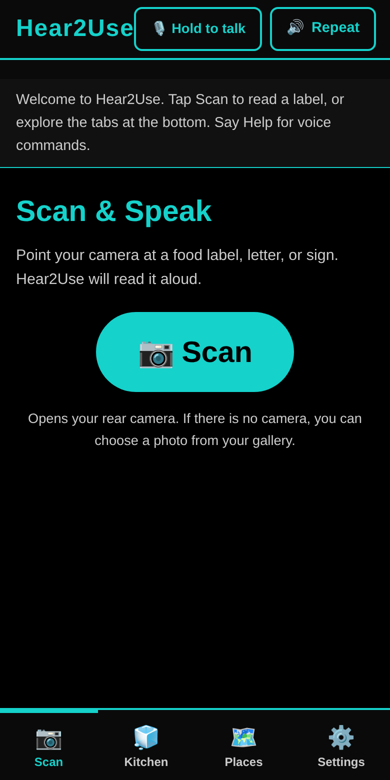
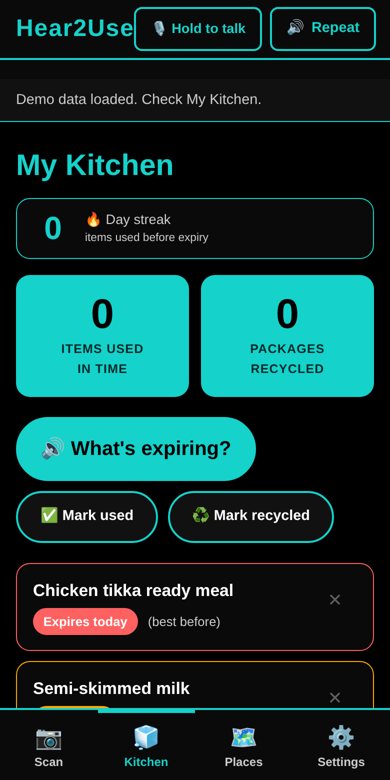
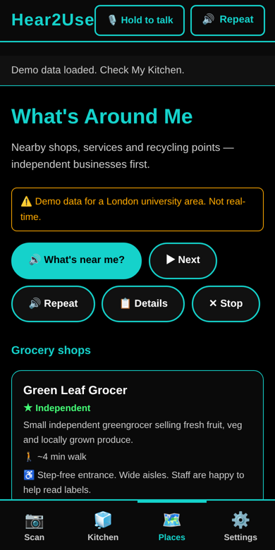

# Hear2Use

> A voice-first web app that helps blind and partially sighted students live independently — less food wasted, correct recycling, and a spoken guide to what's nearby.

**Team Z** · IBM Bob Design Thinking Hackathon · UN SDG 12

**Live demo:** https://johannssatheesh.github.io/Hear2Use/

**My role:** Team lead. I built the prototype with IBM Bob, opened the pitch and came up with the app name and gamified features.

**Final team repo:** [sedmoh/Hear2Use](https://github.com/sedmoh/Hear2Use)

<p>
  
  
  
</p>

---

## Features

| # | Feature | How it works |
|---|---------|-------------|
| 1 | **Scan & Speak** | Tap the Scan button → camera opens → AI reads the label aloud: name, use-by date, date-type explanation, **allergens**, storage advice, recycling disposal |
| 2 | **My Kitchen** | Saved food items sorted by urgency. "What's expiring?" speaks items due within your warning window |
| 3 | **Food Rescued Streak** | Every time you mark an item used in time, your day streak increases. Milestones at 3, 7, 14 and 30 days are announced aloud |
| 4 | **Which Bin? Quiz** | After every food scan, a spoken quiz asks which bin the packaging goes in. Tap the right answer for instant feedback and a recycling point |
| 5 | **Impact Counter** | Weekly counts of items used in time and packages recycled correctly |
| 6 | **What's Around Me** | Spoken tour of 15 nearby places (grocers, cafés, pharmacy, launderette, recycling points, campus) — independent businesses first |
| 7 | **Voice Commands** | Say commands hands-free using Chrome's SpeechRecognition (Android). Keyboard shortcut: **V** or **Space** |
| 8 | **Settings** | API key, speech speed, voice, detail level, warning days, high-contrast mode, "Use app voice" switch |
| 9 | **Demo mode** | Works with no API key — cycles through milk → electricity bill → ready meal |

---

## Try it

Open the live link on your phone in Chrome (Android) or Safari (iOS). It works without an API key using demo data.

To run it locally: `npx serve .` in this folder, then open http://localhost:3000 in Chrome. No build step.

---

## File structure

```
hear2use/
├── index.html          Main HTML — single page, four tab panels
├── styles.css          All styles — two themes (dark / high-contrast)
├── README.md
├── data/
│   └── places.json     Demo places data (15 places, London area)
└── js/
    ├── app.js          Entry point — tab wiring, Media Session API
    ├── scan.js         Camera input, Gemini AI call, demo fallback
    ├── voice.js        speechSynthesis wrapper, aria-live updates
    ├── kitchen.js      Saved food items, expiry warnings, impact counter
    ├── places.js       Nearby places tour (spoken, grouped)
    ├── tips.js         Date logic, urgency labels, speech builder (pure)
    └── settings.js     Settings form, localStorage, theme, demo data
```

---

## How to use the Gemini AI (optional)

The app works fully without an API key — it uses realistic demo results.

To enable real label scanning:

1. Go to [ai.google.dev](https://ai.google.dev) and get a free Gemini API key.
2. Open the app → **Settings** tab → paste your key into **Gemini API Key** → **Save settings**.
3. The key is stored only on your device in `localStorage`. It is never sent anywhere except to Google's Gemini API.

> ⚠️ **Security note:** This is a hackathon prototype. The API key is stored in the browser. In a production app, all AI calls must go through your own server so the key is never exposed to the client. See `js/scan.js` for the comment marking where this change would go.

---

## How to swap the AI provider

All AI code is in **`js/scan.js`** — specifically the `getAIResult()` function.

To swap to a different provider (e.g. OpenAI GPT-4o, Anthropic Claude):

1. Open `js/scan.js`.
2. Find `getAIResult()`.
3. Replace the `fetch()` call and the `body` object with your provider's API.
4. The prompt and the expected JSON shape stay the same.
5. `getDemoResult()` is the fallback — keep it.

The rest of the app does not care which AI you use, as long as `getAIResult()` returns an object matching this shape:

```js
{
  kind:       "food|post|sign|other",
  name:       "product name",
  summary:    "one sentence description",
  date:       "YYYY-MM-DD or null",
  dateType:   "use_by|best_before|expiry|unknown|null",
  storageTip: "storage instruction",
  disposal:   "disposal instruction",
  confidence: "high|medium|low"
}
```

---

## Voice commands

Available on **Chrome for Android** (hold the 🎙️ button in the header, or press **V** or **Space** on a keyboard):

| Say… | Action |
|------|--------|
| `"Scan"` | Opens the camera |
| `"What's expiring"` / `"What's in my kitchen"` | Speaks items expiring soon |
| `"What should I eat first"` | Speaks the most urgent item |
| `"Mark as used"` | Increments items-used counter + streak |
| `"Mark as recycled"` | Increments recycled counter |
| `"Next"` | Speaks the next kitchen item |
| `"Previous"` | Speaks the previous kitchen item |
| `"Repeat"` | Re-speaks the last message |
| `"Places"` / `"What's near me"` | Starts the places tour |
| `"Help"` | Speaks this full command list |

> Voice commands require microphone permission. Chrome on Android will ask on first use. Not supported on Safari iOS — the button is hidden automatically and a clear message is shown.

---

## More

- [2-minute demo script](docs/demo-script.md)
- [Accessibility test checklist](docs/accessibility-checklist.md)

---

## Team

Team Z — IBM Bob Design Thinking Hackathon  
Johanns · Jesse · Vanesa · Fariah · Hayden · Mo

UN SDG 12: Responsible Consumption and Production  
Targets: 12.8 · 12.3 · 12.5 · 10.2
